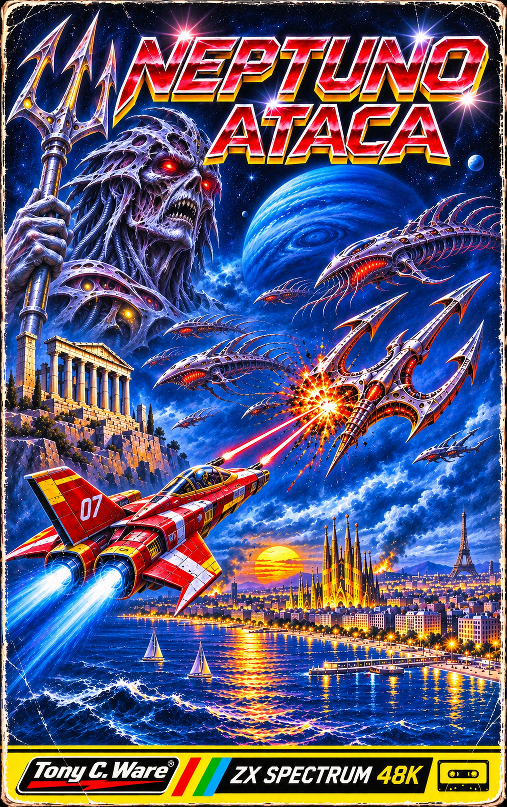
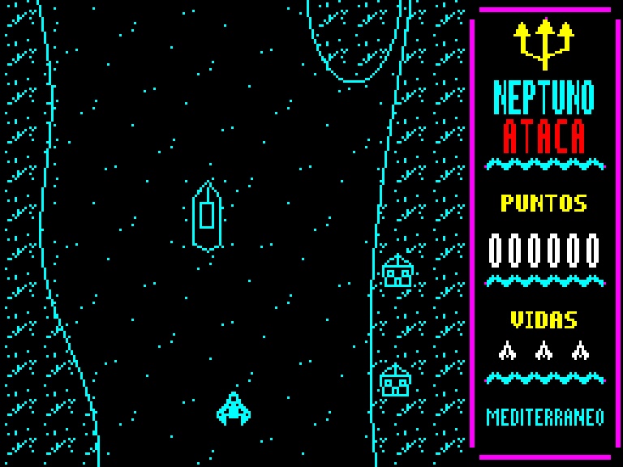

# NEPTUNO ATACA — V1.1

**Tony C. Ware · 2026 · ZX Spectrum 48K**

Matamarcianos vertical de cinco fases, escrito en ensamblador Z80, con scroll continuo, multicarga de cinta y sonido beeper.

## Historia

Los mutantes helados del planeta Neptuno han planeado una invasión total.

Anhelan el calor y harán cualquier cosa para apoderarse de la fuerza vital de nuestro planeta y de la energía del Sol.

Para ello, la Fuerza Anti Mutante Europea ha desplegado su mejor pieza armamentística: el **Cielo Rojo**, un caza interceptor aeroespacial capaz de combatir tanto dentro como fuera de la atmósfera.

Tú estás a los mandos y deberás conseguir que esos mutantes se arrepientan de poner un pie en nuestro planeta.

## Campaña

| Fase | Escenario | Jefe final |
| --- | --- | --- |
| 1 | Mediterráneo | Acorazado Glacial |
| 2 | Grecia | Rodas II |
| 3 | Siria | Tanque Maestro |
| 4 | Francia | Eiffel Mutante |
| 5 | Barcelona | Trono Helado XV |

## Controles

- Q / A / O / P: arriba, abajo, izquierda y derecha.
- SPACE: disparo.
- Joystick Kempston autodetectable.

Disparo frontal ilimitado y power-up SPREAD temporal. Tres vidas.

## Carga

Utiliza un ZX Spectrum 48K o un emulador compatible. Carga el TAP mediante `LOAD ""`. Tras la pantalla de presentación y el beep, pulsa y suelta SPACE o FIRE para continuar. Mantén la cinta disponible para las siguientes fases.

## Tecnología

GRIT ENGINE: renderizado Stack Blast, sprites predesplazados, oleadas coreografiadas y desplazamiento de un píxel. GRIT BEEPER ENGINE: melodía original y efectos sonoros.

## Novedades de la V1.1

Dron circular, pájaro estilo Phoenix con aleteo, torretas direccionales y corrección de la animación del soldado. Se conservan los cinco mapas originales, la campaña, las oleadas, los jefes y el sonido. Edición aprobada por el autor.

## Descargas

- [Juego V1.1 — TAP](NEPTUNO_ATACA_V1.1.tap)
- [Release V1.1 y fuentes](https://github.com/OnRail76/Neptuno-Ataca-ZX/releases/tag/v1.1)
- [Notas de la revisión](DESARROLLO/V1.1/RELEASE_NOTES.md)

### Edición histórica V1.0

- [Juego V1.0 — TAP](NEPTUNO_ATACA_V1.0.tap)
- [Manual original V1.0, atlas y memoria técnica — PDF (sprites anteriores)](NEPTUNO_ATACA_V1.0_MANUAL_ATLAS_MEMORIA.pdf)
- [Edición completa y archivos de la release](https://github.com/OnRail76/Neptuno-Ataca-ZX/releases/tag/v1.0)

[Releases](https://github.com/OnRail76/Neptuno-Ataca-ZX/releases)

© 2026 Tony C. Ware.
